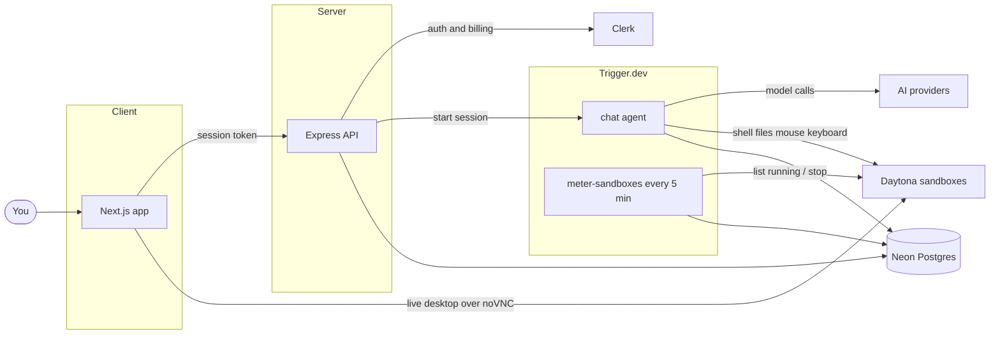

<div align="center">

# Taskmate

### Give AI a real computer — then put any task on it

Research a topic, fill a form, clean a CSV, debug a repo, draft a report, click through a UI. You describe the work; the bot runs it on its own Linux desktop while you watch.

</div>

---

<p align="center">
  
</p>

Taskmate is for getting things done, not collecting chat transcripts. Spin up bots with a job and instructions, hand them one-off or recurring work, and open a live desktop when you want to see the mouse move. Need specialists? Drop several into a group chat and they hand off to whoever owns that part of the task. Paid plans unlock bots and sandboxes; every reply and every running desktop counts against a clear AI and sandbox allowance you can check on Usage.

## Features

- **Any task, one inbox** — ask in plain language; the bot uses shell, files, and a GUI desktop to finish the work
- **Bots you can specialize** — name, face, role, and instructions that stick so a researcher, ops bot, or coder stays on-brief
- **A computer per bot** — Daytona Linux sandbox with terminal, filesystem, and a graphical desktop
- **Live desktop view** — watch the bot click, type, and navigate, streamed into the chat
- **Group chats with handoffs** — several bots in one room pass unfinished work to the teammate whose job it is
- **Memory across chats** — notes saved in one conversation show up in the others
- **Plans and usage limits** — Clerk Billing gates bots and sandboxes; AI spend and sandbox hours are metered per billing period

<p align="center">
  
</p>

## Product tour

| Create a bot | Group chat | Usage |
| --- | --- | --- |
|  |  |  |

## Built with

| Product | What it does here |
| --- | --- |
| **Next.js** (`client/`) | App UI, Clerk session, TanStack Query |
| **Express** (`server/`) | API, Drizzle schema, auth middleware |
| **Trigger.dev** | Durable chat agent and sandbox metering cron |
| **Daytona** | One cloud sandbox per bot |
| **Clerk** | Auth plus Billing for plans, checkout, and feature gates |
| **Neon** | Postgres for bots, chats, and the usage ledger |
| **AI SDK** | Multi-provider models (Gemini, OpenAI, xAI, Anthropic) |

Plus shadcn/ui, Tailwind CSS, React Hook Form, DiceBear, and noVNC for the desktop preview.

## How it works



- A chat turn builds the bot’s instructions from its job and streams a reply with sandbox tools attached. It stops after 50 steps or when the AI allowance is spent.
- In a group chat the bot also gets a handoff tool, which passes the rest of the turn to a teammate.
- Usage is an append-only ledger: model spend is written when a turn completes; sandbox time is charged every five minutes for each running sandbox.

## Getting started

You need Node.js 22.13+, and accounts for [Clerk](https://clerk.com), [Neon](https://neon.tech), [Trigger.dev](https://trigger.dev), and [Daytona](https://www.daytona.io). At least one AI provider API key is required for chat.

**1. Clone and install**

```bash
git clone https://github.com/chukshon/taskmate.git
cd taskmate
cd client && npm install
cd ../server && npm install
```

**2. Environment**

Copy the examples and fill in keys:

```bash
cp client/.env.example client/.env.local
cp server/.env.example server/.env
```

Point `NEXT_PUBLIC_API_URL` at the API (default `http://localhost:3001`). Use Clerk publishable/secret keys in both apps, `DATABASE_URL` / `DATABASE_URL_UNPOOLED` on the server, plus `TRIGGER_SECRET_KEY`, `DAYTONA_API_KEY`, and at least one of `GOOGLE_GENERATIVE_AI_API_KEY`, `OPENAI_API_KEY`, `XAI_API_KEY`, or `ANTHROPIC_API_KEY`.

**3. Billing**

In Clerk, enable Billing for users and create a paid user plan with feature slugs `bots` and `sandboxes`. A seed lives in `client/billing.json` if you configure via the Clerk CLI.

**4. Schema and run**

```bash
cd server
npm run db:push

# terminal 1 — API
npm run dev

# terminal 2 — Trigger.dev tasks
npx trigger.dev@latest dev

# terminal 3 — Next.js
cd ../client
npm run dev
```

Open [http://localhost:3000](http://localhost:3000), sign up, pick a plan, and create your first bot.

## Project layout

```text
client/   Next.js UI, features, TanStack Query services
server/   Express API, Drizzle schema, Trigger.dev tasks
docs/     Screenshots and product docs assets
```

## Contributing

Issues and pull requests are welcome. From `client/` and `server/`, run `npm run lint` and `npm run typecheck` before opening a PR.

---

<div align="center">

Built for handing real work to AI that can actually run a computer — not another chat box.

</div>
