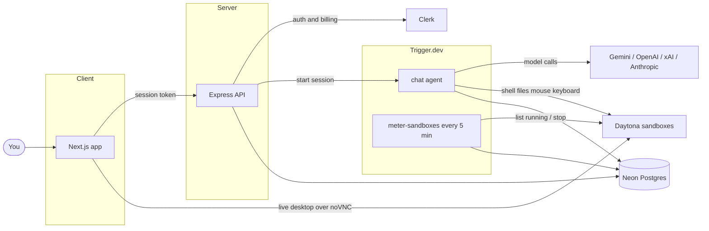

<div align="center">

# Taskmate

### Give AI a real computer — then put any task on it

Research a topic, fill a form, clean a CSV, debug a repo, draft a report, click through a UI. You describe the work; the bot runs it on its own Linux desktop while you watch.

</div>

---

<p align="center">
  
</p>

## What it is

Most AI products stop at a reply. Taskmate is built for **finishing work**.

You create bots — named characters with a job and standing instructions — and talk to them in chat. Behind each bot is an isolated Daytona Linux sandbox: shell, files, and a full graphical desktop. When the task needs a browser, a terminal, or a mouse click, the bot uses those tools itself. Open the desktop panel and you can watch the session live over noVNC.

That changes what you can ask for. Instead of “write a script that would do X,” you can say “do X,” and see it happen. A research bot can open pages and take notes. A code reviewer can clone a repo and walk the diff. An ops-minded bot can edit files, run commands, and leave artifacts in its sandbox for the next turn.

Bots are not one-shot agents. They keep a job and memory across chats, so a specialist stays on-brief. Drop several into a **group chat** and they hand unfinished work to the teammate whose role fits — a researcher passes a draft to an editor, a reviewer picks up after a coder.

There is a free tier to try the product, and a **$10/month** paid plan for bots with their own sandboxes. Every model reply and every running desktop draws down a clear AI and sandbox allowance on the **Usage** page, so cost stays visible while the bots work.

<p align="center">
  
</p>

## What you can do

- **Hand off real work** — ask in plain language; the bot uses shell, files, mouse, and keyboard on its own machine
- **Specialize bots** — name, DiceBear face, job, and instructions (presets for research, code review, writing, tutoring, or your own)
- **Watch the desktop** — live noVNC preview of the sandbox while the bot clicks and types
- **Run a small team** — group chats with handoffs so each bot stays in its lane
- **Remember across chats** — notes a bot saves in one conversation are available in others
- **Pick the model per send** — Gemini, OpenAI, xAI, or Anthropic, with Auto or a named model
- **Free or $10/month** — free to explore; paid unlocks bots and sandboxes, with Usage meters for AI spend and sandbox hours

## Product tour

| Create a bot                                                                                                    | Group chat                                                                                   | Usage                                                                                |
| --------------------------------------------------------------------------------------------------------------- | -------------------------------------------------------------------------------------------- | ------------------------------------------------------------------------------------ |
|  |  |  |

## AI providers

Chat is powered by the [AI SDK](https://ai-sdk.dev) on the server. You can configure one or more providers; the composer only offers ones with a key. Per message you choose a **provider** and a **model** (or **Auto**, which uses that provider’s default).

| Provider             | Env key                        | Models in the app                              |
| -------------------- | ------------------------------ | ---------------------------------------------- |
| **Gemini** (default) | `GOOGLE_GENERATIVE_AI_API_KEY` | Gemini 3.5 Flash-Lite (Auto), Gemini 3.8 Flash |
| **OpenAI**           | `OPENAI_API_KEY`               | GPT-6.1 Terra (Auto), GPT-6.1 Sol              |
| **xAI**              | `XAI_API_KEY`                  | Grok 4.7                                       |
| **Anthropic**        | `ANTHROPIC_API_KEY`            | Claude Haiku 5.5 (Auto), Claude Sonnet 5.5     |

You only need **one** key to chat. Add more keys to unlock more providers in the UI. Missing keys are reported as unavailable instead of failing the whole catalogue. Model spend is recorded on the usage ledger when a turn completes.

## Built with

| Product                 | Role                                           |
| ----------------------- | ---------------------------------------------- |
| **Next.js** (`client/`) | App UI, Clerk session, TanStack Query          |
| **Express** (`server/`) | API, Drizzle schema, auth and billing gates    |
| **Trigger.dev**         | Durable chat agent and sandbox metering cron   |
| **Daytona**             | One cloud Linux sandbox per bot                |
| **Clerk**               | Sign-in and plans (free + $10/month paid)      |
| **Neon**                | Postgres for bots, chats, and the usage ledger |
| **AI SDK**              | Multi-provider chat models                     |

Plus shadcn/ui, Tailwind CSS, React Hook Form, DiceBear, and noVNC for the desktop preview.

## How it works



- When you send a message, the bot sees its job and instructions, then answers while it can use the sandbox (terminal, files, mouse, keyboard). It keeps going until the task is done, it hits a 50-step safety limit, or you run out of AI allowance.
- In a group chat, a bot can pass the rest of the work to another bot whose job fits better.
- After each reply, Taskmate records what that model call cost. Every five minutes it also bills time for any sandbox that is still running.

## Getting started

**Requirements:** Node.js 22.13+, plus accounts for [Clerk](https://clerk.com), [Neon](https://neon.tech), [Trigger.dev](https://trigger.dev), and [Daytona](https://www.daytona.io). At least one AI provider API key is required for chat.

### 1. Clone and install

```bash
git clone https://github.com/chukshon/taskmate.git
cd taskmate
cd client && npm install
cd ../server && npm install
```

### 2. Environment

```bash
cp client/.env.example client/.env.local
cp server/.env.example server/.env
```

#### Client — `client/.env.local`

| Variable                                          | Purpose                                              |
| ------------------------------------------------- | ---------------------------------------------------- |
| `NEXT_PUBLIC_CLERK_PUBLISHABLE_KEY`               | Clerk publishable key                                |
| `CLERK_SECRET_KEY`                                | Clerk secret (Next.js server)                        |
| `NEXT_PUBLIC_CLERK_SIGN_IN_URL`                   | Sign-in route (default `/sign-in`)                   |
| `NEXT_PUBLIC_CLERK_SIGN_UP_URL`                   | Sign-up route (default `/sign-up`)                   |
| `NEXT_PUBLIC_CLERK_SIGN_IN_FALLBACK_REDIRECT_URL` | After sign-in (default `/`)                          |
| `NEXT_PUBLIC_CLERK_SIGN_UP_FALLBACK_REDIRECT_URL` | After sign-up (default `/`)                          |
| `NEXT_PUBLIC_API_URL`                             | Express API origin (default `http://localhost:3001`) |

#### Server — `server/.env`

| Variable                                     | Purpose                                                                |
| -------------------------------------------- | ---------------------------------------------------------------------- |
| `NODE_ENV`                                   | `development` locally                                                  |
| `HOST` / `PORT`                              | API bind (default `0.0.0.0:3001`)                                      |
| `CLIENT_ORIGIN`                              | Allowed Next.js origin (`http://localhost:3000`)                       |
| `LOG_LEVEL`                                  | e.g. `info`                                                            |
| `CLERK_PUBLISHABLE_KEY` / `CLERK_SECRET_KEY` | Same Clerk app as the client                                           |
| `DATABASE_URL`                               | Neon pooled connection string                                          |
| `DATABASE_URL_UNPOOLED`                      | Neon direct URL for `db:push`                                          |
| `NEON_BRANCH`                                | Optional branch label                                                  |
| `GOOGLE_GENERATIVE_AI_API_KEY`               | Gemini (optional if another provider is set)                           |
| `OPENAI_API_KEY`                             | OpenAI                                                                 |
| `XAI_API_KEY`                                | xAI / Grok                                                             |
| `ANTHROPIC_API_KEY`                          | Anthropic / Claude                                                     |
| `TRIGGER_SECRET_KEY`                         | Trigger.dev **dev** key locally; use the production key only in deploy |
| `DAYTONA_API_KEY`                            | Daytona API key                                                        |
| `DAYTONA_API_URL`                            | Daytona API base URL (if required by your org)                         |

### 3. Plans

- **Free** — try the product without paying
- **$10/month** — create bots and run their sandboxes

Without the paid plan, creating bots and opening desktops asks you to subscribe on `/pricing`.

### 4. Schema and run

Three processes: API, Trigger.dev, and Next.js.

```bash
cd server
npm run db:push

# terminal 1 — API
npm run dev

# terminal 2 — Trigger.dev tasks (chat agent + sandbox meter)
npx trigger.dev@latest dev

# terminal 3 — Next.js
cd ../client
npm run dev
```

Open [http://localhost:3000](http://localhost:3000), sign up, pick a plan, create a bot, and send a task. Open the desktop panel when you want to see the sandbox.

## Project layout

```text
client/   Next.js UI, feature modules, TanStack Query services
server/   Express API, Drizzle schema, Trigger.dev tasks, AI providers
```

<div align="center">

Built for handing real work to AI that can actually run a computer — not another chat box.

</div>
